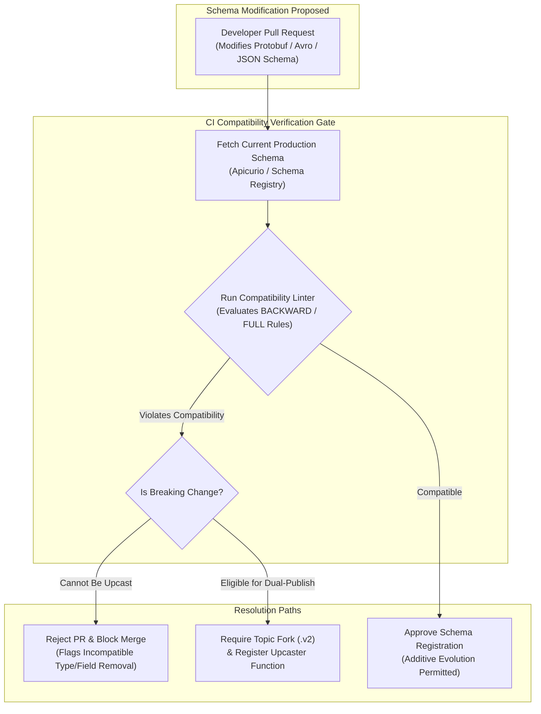
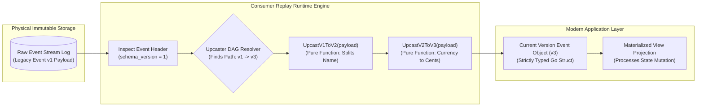
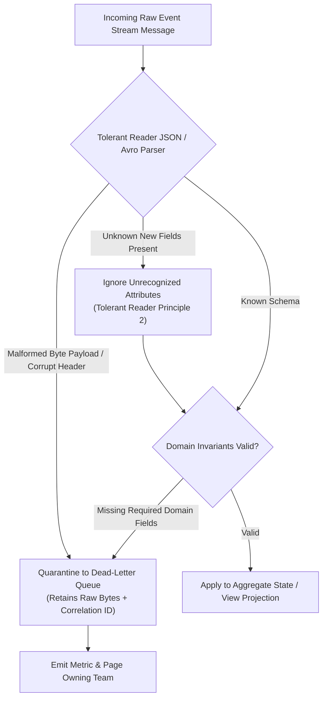

# Schema Evolution Architecture & Runtime Diagrams (WP-16)

This document contains Mermaid diagrams illustrating the runtime architectures, compatibility verification pipelines, recursive upcaster state machines, and dual-publishing lifecycle horizons of the Schema Evolution subsystem per the [Schema Evolution Business Logic Specification](file:///home/btpl-lap-22/live/System-Architect/event-driven-platform/docs/features/schema-evolution/business-logic.md).

---

## 1. Schema Change Validation & CI Linter Gate



---

## 2. In-Memory Recursive Upcaster Replay Pipeline (SE-01, SE-02)



---

## 3. Dual-Publishing & Consumer Migration Timeline (SE-05, SE-06)

```mermaid
sequenceDiagram
    autonumber
    participant Producer as Event Producer Service
    participant Outbox as Transactional Outbox
    participant T1 as Kafka Topic: order.v1
    participant T2 as Kafka Topic: order.v2
    participant C_Old as Legacy Consumer (Reads v1)
    participant C_New as Migrated Consumer (Reads v2)

    Note over Producer,C_New: Phase 1: Dual-Publishing Window (Day 1 - 30)
    Producer->>Outbox: Atomic Insert: [Event_v1, Event_v2] in same DB transaction
    Outbox->>T1: Publish v1 Event Payload
    Outbox->>T2: Publish v2 Event Payload
    T1-->>C_Old: Legacy Consumer processes v1
    T2-->>C_New: Modern Consumer processes v2

    Note over Producer,C_New: Phase 2: Consumer Migration Complete (Day 25)
    C_Old->>C_Old: All consumer groups upgraded to read T2 (order.v2)
    Note over T1: Zero Consumer Lag for 7 Consecutive Days

    Note over Producer,C_New: Phase 3: Decommissioning v1 Topic (Day 31)
    Producer->>Producer: Terminate v1 publishing; publish exclusively to T2
    T1->>T1: Archive topic partitions to cold S3/MinIO storage
```

---

## 4. Tolerant Reader Pattern & Quarantine Quarantine (SE-03, SE-08)



