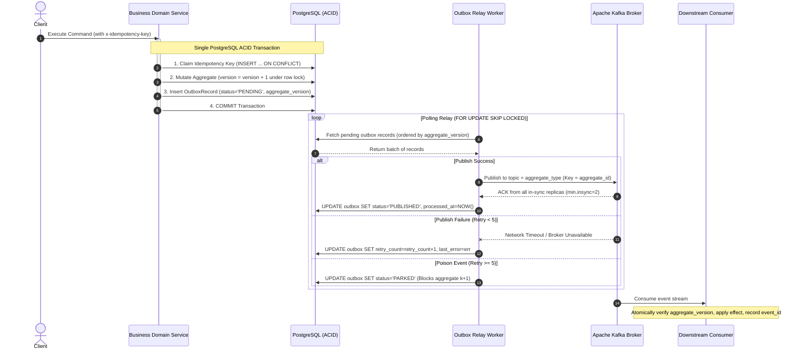

# ADR: Transactional Outbox Pattern for Guaranteed At-Least-Once Event Publishing

* **Status:** Accepted
* **Date:** 2026-11-04
* **Deciders:** Lead Systems Architect & Platform Core Engineering
* **Feature Scope:** `src/features/transactional-outbox/` & `messaging/engine/producers/`

---

## 1. Context and Problem Statement

When domain entities are modified in a relational database and corresponding events must be emitted to a message broker (e.g. Apache Kafka), performing a direct "dual-write" (writing to SQL, then calling `producer.Publish()`) guarantees data corruption:
- If the database transaction commits but the network call to the broker fails or times out, the event is permanently lost, causing downstream projections and sagas to become inconsistent.
- If the event is published first and the database transaction fails (e.g. constraint violation or crash), downstream consumers act on phantom events that never existed in the database.

Distributed transactions (2PC / XA) across Kafka and PostgreSQL are not supported, scale poorly, and introduce latency and operational fragility.

---

## 2. Decision Drivers & Invariants (from business-logic.md v3)

* **INV-01 Atomicity**: Business mutation and outbox insert share ONE connection, ONE transaction, ONE database.
* **INV-02 Delivery Semantics**: At-least-once end to end; exactly-once exists only as an idempotent consumer effect.
* **INV-03 Per-Aggregate Ordering**:
  - Message key = `aggregate_id`.
  - All event types of one aggregate go to ONE topic named after `aggregate_type`.
  - Partition count never changes.
  - Relay preserves commit order per key and never sends $k+1$ before $k$ is acked.
* **INV-04 Version Monotonicity**: Each event carries `aggregate_version = previous + 1`, enforced via unique constraint `(tenant_id, aggregate_type, aggregate_id, aggregate_version)`.
* **INV-05 Event Identity**: `event_id` generated once via RFC 9562 UUIDv7, immutable across retries and replays.
* **INV-06 Single Writer**: `source_service` header guarantees a single service writes an aggregate type.

---

## 3. Architecture & Execution Sequence

---

## 4. Failure Modes and Recovery Matrix

| Node | Failure Scenario | Impact | Mitigation / Handling in Code | Detection |
|---|---|---|---|---|
| **F1.1** | Dual-write attempt | Event Loss / Ghost State | Zero Kafka clients imported in domain feature; all writes go to `outbox` | CI dependency scanner |
| **F1.5** | Concurrent mutations on same aggregate | Race condition / version collision | `UNIQUE(tenant_id, aggregate_type, aggregate_id, aggregate_version)` constraint | SQL Unique Violation (mapped to `ConflictError`) |
| **F2.1** | Kafka down / Relay down | PostgreSQL WAL bloat | Outbox rows accumulate safely as `PENDING`; backpressure monitored | Slot lag bytes & WAL disk alerts |
| **F4.2** | Concurrent workers reorder versions | Downstream corruption | `ORDER BY aggregate_version ASC` + partition key affinity on `aggregate_id` | Consumer gap detector |
| **F4.7** | Poison event payload | Outage on partition | Transitions to `PARKED` after 5 retries; query suppresses versions $> k$ | Alert when `count(status='PARKED') > 0` |
| **INV-03** | Multi-topic split per aggregate | Consumer out-of-order execution | Relay routes to `topic = aggregate_type`, placing `event_type` in headers | Topic derivation audit |

---

## 5. Consequences

### Positive
* Perfect alignment with `business-logic.md` v3 and Debezium Event Router patterns.
* Monotonic versioning guarantees deterministic reordering detection downstream.
* Poison pills park only their specific aggregate, leaving sibling aggregates running smoothly.

### Negative / Tradeoffs
* Parking an aggregate blocks all subsequent versions for that specific entity until an engineer triages the payload.
* Database write overhead: requires an INSERT and status UPDATE per event.
