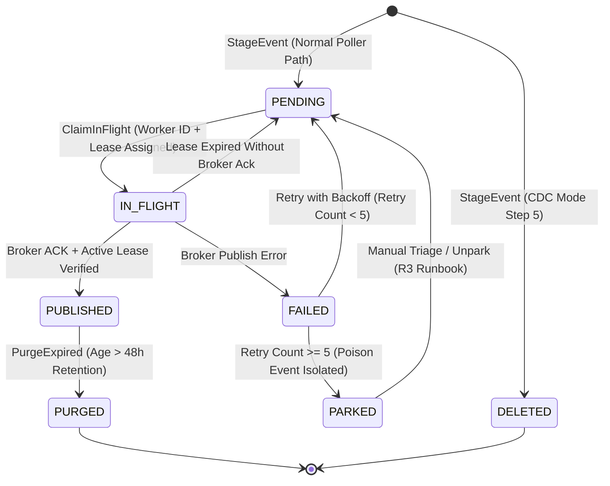
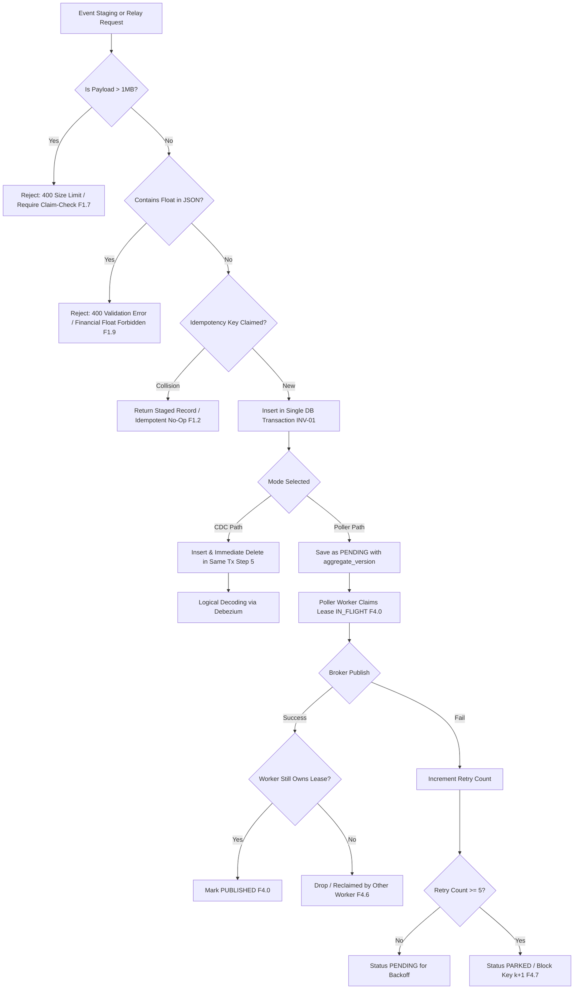

# ADR: Transactional Outbox Pattern for Guaranteed At-Least-Once Event Publishing

* **Status:** Accepted
* **Date:** 2026-11-04
* **Deciders:** Lead Systems Architect & Platform Core Engineering
* **Feature Scope:** `src/features/transactional-outbox/`, `src/api/`, `messaging/engine/`

---

## 1. Context and Problem Statement

When domain entities are modified in a relational database and corresponding events must be emitted to a message broker (e.g. Apache Kafka), performing a direct "dual-write" (writing to SQL, then calling `producer.Publish()`) guarantees data corruption:
- If the database transaction commits but the network call to the broker fails or times out, the event is permanently lost, causing downstream projections and sagas to become inconsistent.
- If the event is published first and the database transaction fails (e.g. constraint violation or crash), downstream consumers act on phantom events that never existed in the database.

Distributed transactions (2PC / XA) across Kafka and PostgreSQL are not supported, scale poorly, and introduce latency and operational fragility.

---

## 2. Decision Drivers & Invariants (from business-logic.md v3)

* **INV-01 Atomicity**: Business mutation and outbox insert share ONE connection, ONE transaction, ONE database.
* **INV-02 Delivery Semantics**: At-least-once end to end; exactly-once exists only as an idempotent consumer effect.
* **INV-03 Per-Aggregate Ordering**:
  - Message key = `aggregate_id`.
  - All event types of one aggregate go to ONE topic named after `aggregate_type`.
  - Partition count never changes.
  - Relay preserves commit order per key and never sends $k+1$ before $k$ is acked.
* **INV-04 Version Monotonicity**: Each event carries `aggregate_version = previous + 1`, enforced via unique constraint `(tenant_id, aggregate_type, aggregate_id, aggregate_version)`.
* **INV-05 Event Identity**: `event_id` generated once via RFC 9562 UUIDv7, immutable across retries and replays.
* **INV-06 Single Writer**: `source_service` header guarantees a single service writes an aggregate type.
* **INV-09 Business Idempotency**: Step 1 claims `x-idempotency-key` in `outbox_idempotency_keys` table; retry with identical key is a no-op.
* **INV-12 Payload Fidelity**: Financial numbers strictly forbidden as float; integer minor units or decimal strings only. Payloads > 1MB require claim-check.

---

## 3. End-to-End Architectural Diagrams

### 3.1 Write Path & Poller Relay with Fencing Sequence

---

### 3.2 Outbox Record State Machine Diagram

---

### 3.3 Failure Modes and Handling Matrix

---

## 4. Comprehensive Failure Mode Engineering Reference

| Failure Code | Scenario | Impact | Code Handling & Architectural Guardrail | Detection |
|---|---|---|---|---|
| **F1.1** | Dual-write attempt | Event Loss / Ghost State | Zero Kafka clients imported in domain feature; all writes go to `outbox` | CI dependency scanner |
| **F1.2** | Ambiguous commit / network drop | Duplicate aggregate & event | Step 1 claims `x-idempotency-key` in `outbox_idempotency_keys` table; retry returns existing record | Unique violation counter |
| **F1.5** | Concurrent mutations on same aggregate | Race condition / version collision | `UNIQUE(tenant_id, aggregate_type, aggregate_id, aggregate_version)` constraint | SQL Unique Violation (mapped to `ConflictError`) |
| **F1.7** | Oversized payload | Broker partition block / poison pill | Write-time rejection of payloads > 1MB (`IsPayloadSizeValid`); requires claim-check | Payload size histogram |
| **F1.9** | Floating-point numbers in payload | Financial precision loss & cents drift | `HasFloatingPointNumbers` scans payload and rejects floats (`.`, `e`, `E`) | Validation error counter |
| **F2.1** | Kafka down / Relay down | PostgreSQL WAL bloat | Outbox rows accumulate safely as `PENDING`; backpressure monitored | Slot lag bytes & WAL disk alerts |
| **F4.0** | Row locks held during network send | Lock pileup & DB outage | Lease model: records claimed as `IN_FLIGHT` with worker ID and lease expiry | Oldest transaction age |
| **F4.2** | Concurrent workers reorder versions | Downstream corruption | `ORDER BY aggregate_version ASC` + partition key affinity on `aggregate_id` | Consumer gap detector |
| **F4.6** | Worker lease expires during dispatch | Duplicates & race collision | `MarkPublishedByWorker` fences confirm step on worker ownership & active lease | Reclaim counter |
| **F4.7** | Poison event payload | Outage on partition | Transitions to `PARKED` after 5 retries; query suppresses versions $> k$ | Alert when `count(status='PARKED') > 0` |
| **F9.1** | Silent flow stoppage | Undetected outage | Synthetic canary heartbeat emitted every ~30s (`EmitCanaryHeartbeat`) | Canary consumer latency |

---

## 5. Consequences & Tradeoffs

### Positive
* Complete parity with `business-logic.md` v3 production decision tree.
* Worker lease claiming eliminates long database transactions while preventing worker race conditions via fencing.
* Financial precision and idempotency guarantees protect downstream ledgers from duplicate or rounded financial data.
* Poison-pill isolation operates per-aggregate, ensuring a bad record halts only that entity without impacting other tenants or aggregates.

### Negative / Tradeoffs
* Parking an aggregate blocks all subsequent versions for that specific entity until an engineer triages the payload (Section 11 R3 runbook).
* Lease model requires periodic clock synchronization across poller worker nodes to maintain lease accuracy.
