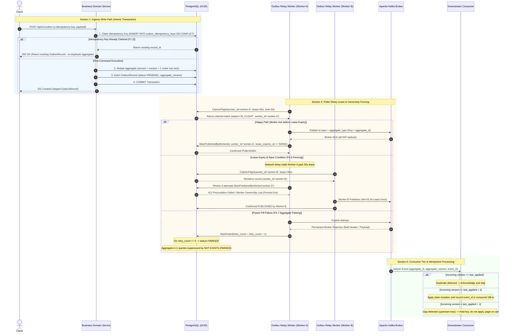
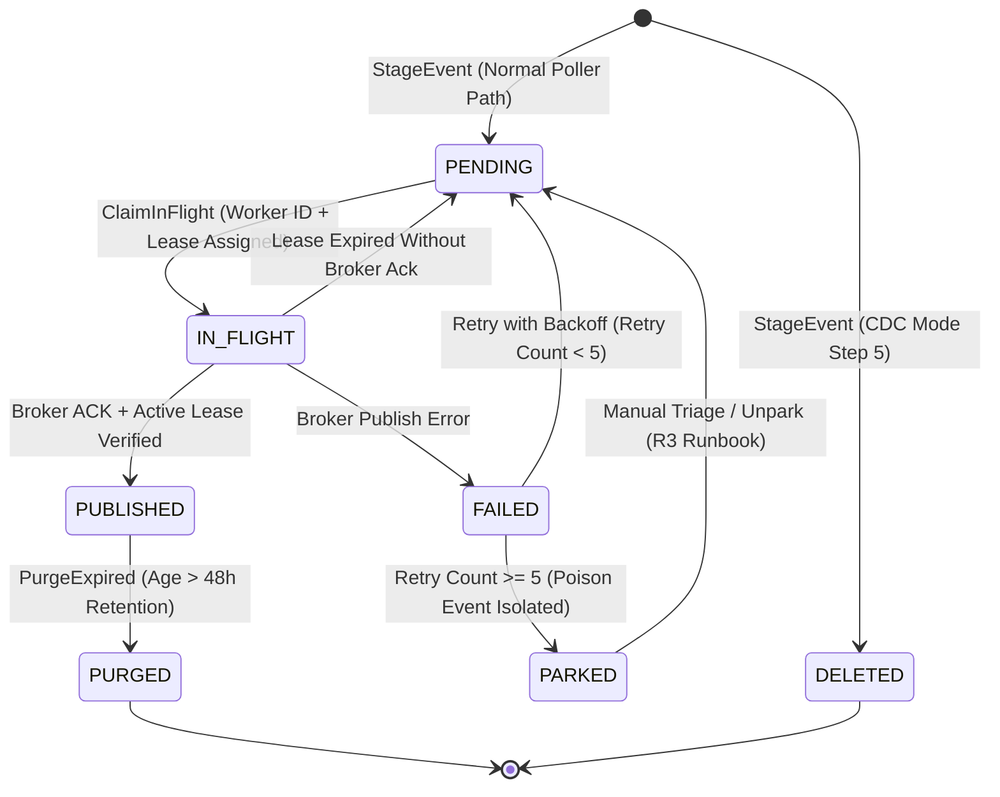

# Transactional Outbox: Architectural Decision Record & Production Reference

* **Status:** Accepted
* **Date:** 2026-11-04
* **Deciders:** Lead Systems Architect & Platform Core Engineering
* **Feature Scope:** `src/features/transactional-outbox/`, `src/api/`, `messaging/engine/`

---

## 1. Context and Problem Statement

When domain entities are modified in a relational database and corresponding events must be emitted to a message broker (e.g. Apache Kafka), performing a direct "dual-write" (writing to SQL, then calling `producer.Publish()`) guarantees data corruption:
- If the database transaction commits but the network call to the broker fails or times out, the event is permanently lost, causing downstream projections and sagas to become inconsistent.
- If the event is published first and the database transaction fails (e.g. constraint violation or crash), downstream consumers act on phantom events that never existed in the database.

Distributed transactions (2PC / XA) across Kafka and PostgreSQL are not supported, scale poorly, and introduce latency and operational fragility.

---

## 2. Invariants (System-Wide Truths)

* **INV-01 Atomicity**: Business mutation and outbox insert share ONE connection, ONE transaction, ONE database.
* **INV-02 Delivery Semantics**: At-least-once end to end; exactly-once exists only as an idempotent consumer effect.
* **INV-03 Per-Aggregate Ordering**:
  - Message key = `aggregate_id`.
  - All event types of one aggregate go to ONE topic named after `aggregate_type`.
  - Partition count never changes.
  - Relay preserves commit order per key and never sends $k+1$ before $k$ is acked.
* **INV-04 Version Monotonicity**: Each event carries `aggregate_version = previous + 1`, enforced via unique constraint `(tenant_id, aggregate_type, aggregate_id, aggregate_version)`.
* **INV-05 Event Identity**: `event_id` generated once via RFC 9562 UUIDv7, immutable across retries and replays.
* **INV-06 Single Writer**: `source_service` header guarantees a single service writes an aggregate type.
* **INV-07 No Ghost Events**: Never publish an event whose transaction can still be lost (async commit, async failover).
* **INV-09 Business Idempotency**: Step 1 claims `x-idempotency-key` in `outbox_idempotency_keys` table; retry with identical key is a no-op.
* **INV-11 Retention Chain**: Source-of-truth retention $\ge$ Kafka retention $\ge$ consumer dedupe window $\ge$ provider idempotency window.
* **INV-12 Payload Fidelity**: Financial numbers strictly forbidden as float; integer minor units or decimal strings only. Payloads > 1MB require claim-check.
* **INV-14 Observability Completeness**: Absence of metrics is an alert condition, never a healthy state.

---

## 3. End-to-End Architectural Diagrams

### 3.1 Write Path & Poller Relay with Fencing Sequence

### 3.2 Outbox Record State Machine Diagram

---

## 4. Specific Edge Cases and Deep Failure Handling

### 4.1 Write Path Edge Cases
1. **F1.2 Ambiguous Commit (Connection drops during COMMIT)**:
   - *Impact*: Client does not know if the transaction committed. Naive retries could double-charge or create two aggregates.
   - *Mitigation*: Step 1 claims `x-idempotency-key` in `outbox_idempotency_keys` table with primary key `(tenant_id, idempotency_key)`. The retry hits `ON CONFLICT DO NOTHING`, detects the collision, and returns the existing `OutboxRecord` without creating duplicate aggregates or outbox rows.
2. **F1.5 Concurrent Mutations on Same Aggregate**:
   - *Impact*: Two concurrent business transactions assign the same version or produce an out-of-order WAL commit sequence.
   - *Mitigation*: DB unique constraint `UNIQUE (tenant_id, aggregate_type, aggregate_id, aggregate_version)` causes the slower concurrent transaction to abort with a SQL unique violation, mapped to `ConflictError` (HTTP 409).
3. **F1.7 Oversized Payloads**:
   - *Impact*: Payloads exceeding broker request size limit (e.g., 1MB) become permanent poison events that stall partition processing.
   - *Mitigation*: `rules.IsPayloadSizeValid` rejects payloads $> 1\text{MB}$ at ingress before database persistence.
4. **F1.9 Floating-Point Precision Loss**:
   - *Impact*: `float64` floating point parsing drifts currency cents over time and rounds 64-bit integers $> 2^{53}$.
   - *Mitigation*: `rules.HasFloatingPointNumbers` parses numeric tokens and rejects any JSON payload containing `.`, `e`, or `E`.

### 4.2 Relay & Poller Edge Cases
1. **F4.0 / F4.1 Lock Holding Across Network**:
   - *Impact*: Holding database row locks open while awaiting Kafka network acks pins PostgreSQL vacuum horizons, accumulates table bloat, and exhausts connection pools.
   - *Mitigation*: Lease-based claim model. Poller marks records `IN_FLIGHT` with `worker_id` and `lease_expires_at` in a short transaction, releases the lock, performs the network publish asynchronously, and marks `PUBLISHED` in a separate short transaction.
2. **F4.3 Commit-Order Visibility Gap**:
   - *Impact*: A transaction with an earlier timestamp commits *after* a poller has read past that timestamp. Watermark/cursor-based querying skips the committed event forever.
   - *Mitigation*: Queries never filter on `id > last_seen_id` or `created_at > last_seen_timestamp`. Queries select strictly by `status = 'PENDING' OR (status = 'IN_FLIGHT' AND lease_expires_at < NOW())`.
3. **F4.6 Lease Expiration Fencing**:
   - *Impact*: Worker A experiences a GC pause or network stall exceeding its 30s lease. Worker B reclaims the batch and publishes. Worker A awakens and attempts to mark the records published, overwriting subsequent state.
   - *Mitigation*: `MarkPublishedByWorker` queries `WHERE tenant_id = $1 AND id = $2 AND worker_id = $3 AND (lease_expires_at IS NULL OR lease_expires_at >= NOW())`. If 0 rows are affected, Worker A is fenced out and returns `ErrWorkerOwnershipLost`.
4. **F4.7 Poison Event / Poison Aggregate Parking**:
   - *Impact*: A record with an unroutable schema or broker-rejected payload fails permanently. Skipping it and publishing version $k+1$ violates INV-03 per-aggregate ordering.
   - *Mitigation*: After 5 consecutive publish errors, the record transitions to `PARKED`. The relay query includes `AND NOT EXISTS (SELECT 1 FROM outbox p WHERE p.aggregate_id = o.aggregate_id AND p.status = 'PARKED')`, safely halting all subsequent versions for that specific entity while allowing sibling aggregates to proceed without partition stalls.
5. **F4.11 Cleanup Deletes Unpublished Rows**:
   - *Impact*: Purge queries inadvertently truncate pending or stalled events.
   - *Mitigation*: `FlowPurgeExpiredPublishedRecords` explicitly filters `WHERE status = 'PUBLISHED' AND created_at < NOW() - INTERVAL '48 hours'`. It is mathematically impossible for a `PENDING`, `IN_FLIGHT`, or `PARKED` row to be deleted by cleanup jobs.

---

## 5. Comprehensive Failure Mode Reference Matrix

| Code | Failure Scenario | Impact | Code Mitigation | Live Detection |
|---|---|---|---|---|
| **F1.1** | Dual-write attempt | Event loss or ghost event | Zero Kafka imports in business services; mandatory outbox insertion | CI dependency scanner |
| **F1.2** | Ambiguous commit | Duplicate aggregate & event | `outbox_idempotency_keys` table claims key first; retries return existing record | Idempotency conflict rate |
| **F1.5** | Concurrent aggregate write | Version collision | `UNIQUE (tenant_id, aggregate_type, aggregate_id, aggregate_version)` | Unique constraint violation metric |
| **F1.7** | Oversized payload | Broker rejection & partition block | Hard write-time check $\le 1\text{MB}$ in `rules.IsPayloadSizeValid` | Payload size histogram |
| **F1.9** | Float in JSON contract | Financial cents drift | `rules.HasFloatingPointNumbers` rejects floats in JSON numbers | Contract validation error counter |
| **F1.14** | Null key or aggregate ID | Skipping / unroutable event | `rules.ValidateOutboxInput` enforces non-empty strings on all identifiers | Validation failure metric |
| **F2.1** | Kafka down / broker halt | Postgres disk bloat | Records stay safely `PENDING`; backpressure monitored | Slot lag bytes & WAL free disk % |
| **F4.0** | Row lock held over network | DB connection exhaustion | Lease model: records claimed as `IN_FLIGHT`, send without open DB tx | Oldest active transaction age |
| **F4.2** | Multiple workers reorder versions | Downstream corruption | Batch ordered by `aggregate_version ASC`; hash partition affinity on `aggregate_id` | Consumer gap detector |
| **F4.6** | Worker lease expires mid-send | Overwrite / race condition | `MarkPublishedByWorker` fences updates on worker ownership & active lease | Reclaim counter spike |
| **F4.7** | Poison event | Partition outage | Retry count $\ge 5 \to \text{PARKED}$; queries block subsequent versions $k+1$ | Alert when `count(status='PARKED') > 0` |
| **F4.11** | Retention purge deletes pending | Silent data loss | Purge query strictly filters `WHERE status = 'PUBLISHED'` | Purge count vs published count |
| **F9.1** | Silent pipeline stoppage | Undetected loss | Synthetic canary emitted every ~30s (`EmitCanaryHeartbeat`) | Canary consumer latency SLO |

## Amendment 2026-11-07: Duplicate-externalId conflict mapping and Kafka relay headers

### Problem observed
1. `POST /api/v1/outbox` with a second request that reuses the same `externalId` (same tenant and source service) but no idempotency key returned `500 INTERNAL_ERROR`. A duplicate is a client-side condition and should be a conflict.
2. Messages published by the relay (`RelayBatch`) arrived on Kafka with no record headers. A console consumer showed `NO_HEADERS`, although the outbox row stores `event_type`, `schema_version` and `source_service` in its `headers` column. Consumers therefore could not route or version-check without parsing the payload.

### Root cause
1. `transactional-outbox.postgres.repository.adapter.go: Save / SaveAndImmediateDelete` returned the raw `*pq.Error` for unique violations (`outbox_external_uk`, `outbox_aggregate_version_uk`). The service wrapped it with `%w` and the handler never matched it to a 409 (RC1, RC2). The in-memory adapter did not enforce the idempotency key, so unit tests on it could not see the defect (RC5).
2. `ProducerPort.Publish(ctx, topic, key, payload)` has no headers parameter, and `RelayBatch` called it directly, so the stored headers were dropped at the last hop (RC4-style gap: the stored contract was never exercised end to end).

### Decision / fix
- `mapInsertError` in the Postgres adapter converts SQLSTATE 23505 into an `ApplicationError` conflict: `outbox_external_uk` -> "an outbox event with the same externalId already exists for this tenant and source service"; `outbox_aggregate_version_uk` -> "an outbox event for this aggregate version already exists"; any other unique violation -> "duplicate outbox event". `OutboxService.StageEvent` now uses `errors.As` and returns the `ApplicationError` unwrapped, and the handler uses `errors.As`. The memory adapter now enforces the idempotency key so both adapters behave the same.
- Headers: a new optional interface `producers.HeaderedProducerPort` (`PublishWithHeaders`) and helper `producers.PublishRecord`. The Kafka adapter sends headers in sorted key order; the memory producer records them. `ProducerPort` itself is unchanged, so producers that do not support headers keep working (the helper falls back to plain `Publish`). We chose an optional extension over changing `ProducerPort` to avoid breaking every implementation and mock.
- Contract now enforced on relay (verified in `outbox.service.go`):
  - Kafka topic == the row's `aggregate_type`; message key == `aggregate_id`; value == `payload`.
  - Headers `event_type`, `schema_version`, `source_service` are always set at staging from the request, and any custom `headers` supplied in the request are carried too. They are sent as Kafka record headers.

### API-visible behavior change
- `POST /api/v1/outbox` duplicate `externalId` without idempotency key: `500` -> `409 CONFLICT` with a domain message. Clients that treated 500 as retryable will now see a non-retryable 409. Marked as a behavior change, arguably breaking for clients that special-cased 500.
- Kafka consumers now see record headers; additive.

### Verification
- Live (image `chiefj/event-driven-platform:fixes`, compose stack): duplicate externalId returned 409; the relayed Kafka record showed `event_type:E,schema_version:1,source_service:s`.
- Unit tests added in `src/features/transactional-outbox/tests/outbox_headers_conflict_test.go`: `TestOutboxDuplicateExternalIDIsConflict`, `TestOutboxRelayCarriesHeaders`.

### Remaining gaps
- The unique-violation mapping in the Postgres adapter has no Postgres-backed test in CI (only the live check above); Postgres-dependent integration tests skip silently (RC5).
- Topic provisioning is an operational prerequisite, not enforced by code (see RC6 below).

### Operational prerequisite (RC6): topic must exist before relay
The relay publishes to the Kafka topic named by `aggregate_type`, and the broker has topic auto-creation disabled. If the topic does not exist, publishing fails with "Unknown Topic Or Partition", the row is marked failed on each attempt, and after 5 retries it is PARKED. This is not a code defect. Create topics (with the intended partition count) before staging events for a new `aggregate_type`; see `failure-cases.md` for the recovery procedure.
