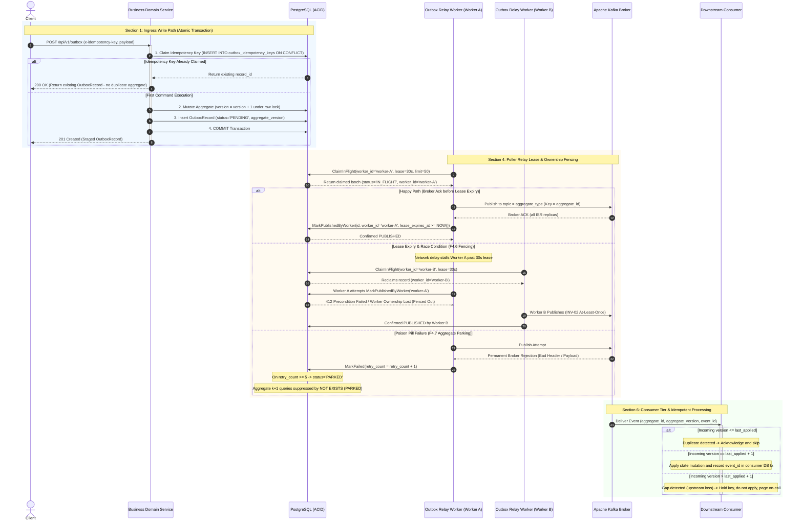
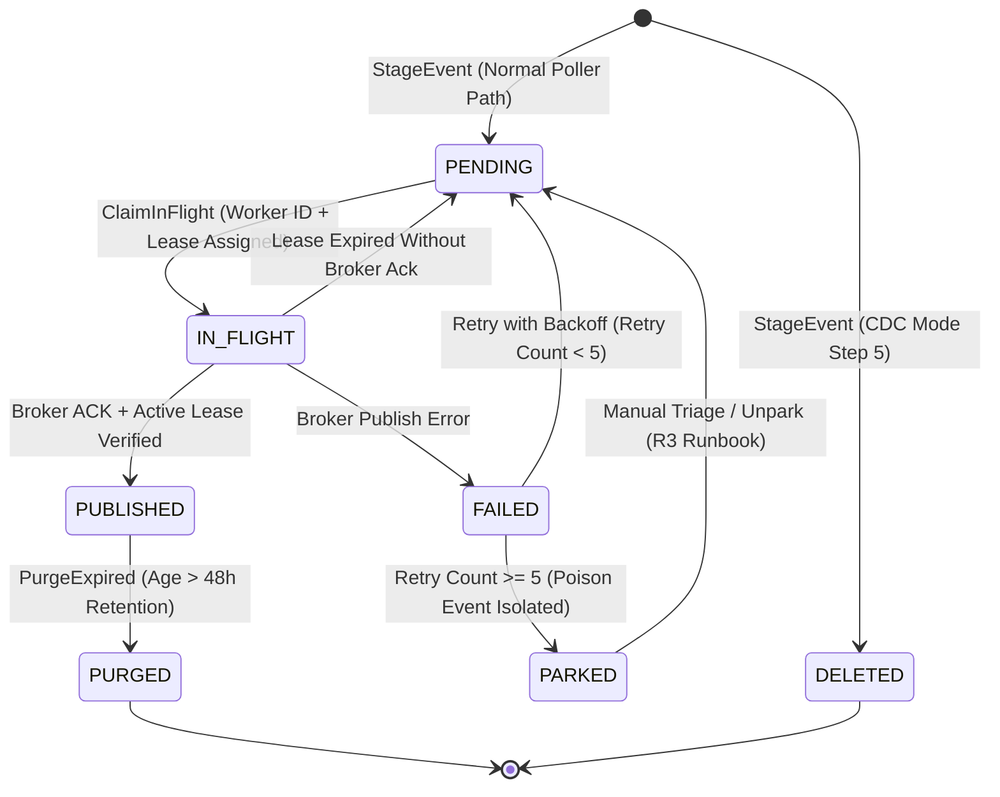
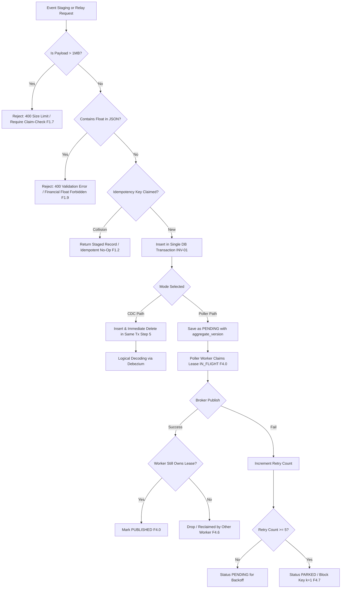

# Transactional Outbox: Architectural Diagrams

## 1. End-to-End Sequence Diagram (Write Path, Poller Relay & Consumer)

## 2. Outbox Record State Machine Diagram

## 3. Failure Mode Decision & Mitigation Tree

